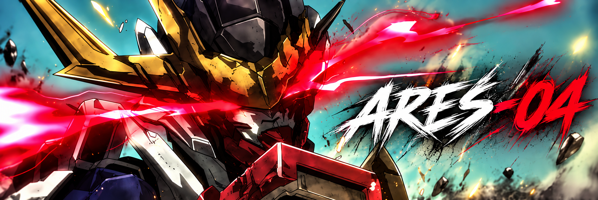
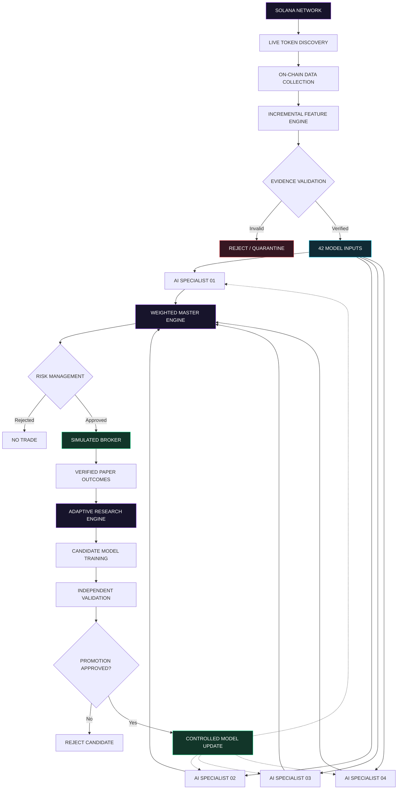
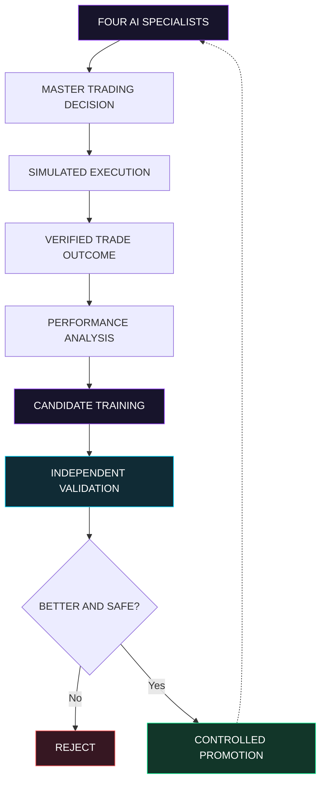

# ARES-04-Public (Private Until Release)

 <div align="center">



# ARES-04

### Autonomous Intelligence for Solana Markets

**ON-CHAIN ANALYTICS · FOUR AI SPECIALISTS · ADAPTIVE LEARNING · PAPER TRADING**


**RESEARCH THE LAUNCH. VERIFY THE SIGNAL. TEST THE EDGE.**

---

</div>

## `> 01 / SYSTEM OVERVIEW`

**ARES-04 is an experimental, AI-powered Solana trading research platform designed to analyze newly launched tokens, identify potential trading opportunities, simulate execution, and learn from verified trading outcomes.**

The platform combines real-time blockchain monitoring, historical market analysis, four specialized machine-learning models, a weighted trading council, and a controlled model-improvement pipeline.

ARES-04's objective is not simply to predict whether a token's price will rise.

It is designed to answer a more difficult question:

> **Can an autonomous system identify repeatable trading opportunities, execute them under realistic simulated conditions, learn from its outcomes, and demonstrate measurable improvement on unseen market data?**

The project focuses on the earliest stages of Solana token launches, when market conditions can change within seconds and traditional indicators may provide limited information about underlying wallet behavior.

ARES-04 is a research and paper-trading platform. Real-money execution is not enabled.

---

## `> 02 / THE CORE ARCHITECTURE`

### One network. Four specialists. One coordinated intelligence system.



The architecture separates data collection, feature verification, model inference, execution simulation, and learning.

Each component has a defined responsibility, allowing the system to evaluate its own decisions without contaminating historical research data or bypassing risk controls.

---

## `> 03 / FIRST-HOUR MARKET INTELLIGENCE`

### The first 60 minutes can reveal the market's structure.

ARES-04 is designed to capture the early lifecycle of newly launched Solana tokens through observations at **15-second intervals**.

```text
TOKEN DEPLOYMENT
       │
       ├── 00:15  Initial activity
       ├── 00:30  Early liquidity
       ├── 01:00  Trading behavior
       ├── 05:00  Wallet participation
       ├── 10:00  Holder concentration
       ├── 15:00  Market structure
       ├── 30:00  Liquidity development
       └── 60:00  First-hour research complete
```

### Data categories

| Intelligence layer | Research focus |
|---|---|
| Market activity | Trades, volume, transaction frequency, buying and selling |
| Liquidity analysis | Reserves, liquidity changes, market depth |
| Wallet intelligence | Holder distribution, concentration, connected wallets |
| Creator attribution | Developer relationships, launch evidence, funding origins |
| Market transitions | Token migration and terminal-state evidence |
| Temporal verification | Event timestamps, finality, availability |
| Outcome analysis | Future price behavior and execution feasibility |

ARES-04 aims to understand not only **what the market is doing**, but also which observable conditions preceded subsequent outcomes.

---

## `> 04 / THE FOUR-SPECIALIST AI COUNCIL`

### Independent predictions. Collective decisions.

ARES-04 operates four frozen specialist machine-learning models that evaluate verified market features.

Each specialist produces an independent prediction. The master engine combines these predictions using a weighted decision process and applies additional risk constraints.

```text
┌────────────────────────────────────────────────────────┐
│                  ARES-04 AI COUNCIL                   │
├────────────────────────────────────────────────────────┤
│                                                        │
│   ┌────────────┐              ┌────────────┐           │
│   │ SPECIALIST │              │ SPECIALIST │           │
│   │     01     │              │     02     │           │
│   └─────┬──────┘              └──────┬─────┘           │
│         │                            │                 │
│         └──────────┐    ┌────────────┘                 │
│                    ▼    ▼                              │
│               MASTER ENGINE                            │
│                    ▲    ▲                              │
│         ┌──────────┘    └────────────┐                 │
│         │                            │                 │
│   ┌─────┴──────┐              ┌──────┴─────┐           │
│   │ SPECIALIST │              │ SPECIALIST │           │
│   │     03     │              │     04     │           │
│   └────────────┘              └────────────┘           │
│                                                        │
│           WEIGHTED DECISION + RISK GUARDS              │
│                                                        │
└────────────────────────────────────────────────────────┘
```

### Decision outcomes

| Decision | Meaning |
|---|---|
| `ENTER` | Consider opening a simulated position |
| `HOLD` | Maintain an existing simulated position |
| `EXIT` | Consider closing a simulated position |
| `WAIT` | No acceptable opportunity identified |
| `REJECT` | Required evidence or risk conditions not satisfied |

These are conceptual decision categories; the underlying implementation may use more specific internal states.

**No individual specialist can bypass the master engine or risk controls.**

---

## `> 05 / ADAPTIVE INTELLIGENCE`

### The system doesn't just predict. It's designed to learn.

ARES-04's long-term architecture includes a feedback-driven learning pipeline that uses verified simulated trading outcomes to develop improved candidate models.

Every eligible completed paper trade can contribute evidence about entry timing, exit performance, liquidity conditions, execution costs, and prediction quality.

This creates a research cycle in which models can be evaluated against their own decisions.

### The learning loop



### What ARES-04 learns from

| Research signal | Learning objective |
|---|---|
| Profitable entries | Identify conditions associated with favorable timing |
| Losing trades | Recognize patterns associated with unsuccessful decisions |
| Exit timing | Evaluate when closing positions was advantageous |
| Liquidity | Understand whether trades were realistically executable |
| Wallet behavior | Analyze relationships between on-chain activity and outcomes |
| Momentum | Evaluate price and transaction changes |
| Execution costs | Measure the impact of fees, slippage, and liquidity |
| Specialist disagreement | Investigate uncertainty and conflicting predictions |
| Market conditions | Test strategy performance across different regimes |

Rejected opportunities can also be studied when independent forward-market observations exist, but they are not counted as completed trades.

### Candidate model development

The adaptive system separates the models currently making predictions from candidates being trained in the research environment.

```text
FROZEN PRODUCTION MODELS
          │
          ▼
VERIFIED PAPER OUTCOMES
          │
          ▼
ELIGIBLE RESEARCH FEEDBACK
          │
          ▼
CANDIDATE MODEL TRAINING
          │
          ▼
INDEPENDENT VALIDATION
          │
     ┌────┴────┐
     ▼         ▼
   REJECT    APPROVE
               │
               ▼
      CONTROLLED PROMOTION
```

A newly trained candidate does not automatically replace an existing specialist.

The learning pipeline must establish sufficient sample coverage, valid evaluation methodology, and evidence of improvement before a candidate becomes eligible for promotion.

### Learning safeguards

| Requirement | Minimum research condition |
|---|---|
| Verified completed trades | 30 |
| Independent tokens | 10 |
| Class coverage | Adequate representation |
| Validation | Valid grouped folds |
| Generalization | Later-token validation |
| Estimated exits | Excluded from confirmed feedback |
| Promotion | Separate validation and approval |

These are minimum research gates, not proof that a candidate is profitable.

**The objective is controlled adaptation, not automatic retraining after every trade.**

---

## `> 06 / SIMULATED EXECUTION ENGINE`

### Predictions are not profits. Execution matters.

ARES-04 includes a simulated broker designed to evaluate trading strategies without risking real capital.

The execution layer considers whether a proposed trade could realistically have occurred under the available market conditions.

### Execution considerations

- Available liquidity
- Simulated order sizing
- Entry and exit prices
- Trading fees and slippage
- Stale or missing quotes
- Rejected or unsuccessful fills
- Position management
- Realized simulated performance

```text
┌───────────────────────────────────────────────────┐
│               ARES-04 PAPER BROKER              │
├───────────────────────────────────────────────────┤
│                                                   │
│  EXECUTION MODE      SIMULATION ONLY              │
│  CAPITAL             SIMULATED SOL                │
│  MARKET INPUTS       VERIFIED EVIDENCE            │
│  POSITION RULES      RISK CONTROLLED              │
│  REAL TRANSACTIONS   DISABLED                     │
│                                                   │
│  RESULT: VERIFIED SIMULATED OUTCOMES              │
│                                                   │
└───────────────────────────────────────────────────┘
```

An estimated exit is not equivalent to a verified completed trade.

Only outcomes that meet the required verification conditions can be used as confirmed trading feedback.

---

## `> 07 / PREDICTION-TIME INTEGRITY`

### No future information. No fabricated evidence.

One of ARES-04's most important engineering requirements is ensuring that every prediction uses only information available at the time the decision was made.

The system uses evidence verification and provenance tracking to protect against look-ahead bias.

### Core integrity rules

- Model inputs must be supported by source evidence.
- Evidence availability must satisfy the prediction deadline.
- Missing values require valid computation and timing proofs.
- Conflicting or incomplete evidence must be rejected or quarantined.
- Historical reconstruction must not silently alter prior decisions.
- Training data and paper-trading feedback must remain independently auditable.

The incremental processing architecture is designed to keep these guarantees while avoiding repeated full-history reconstruction on every checkpoint.

**If the evidence cannot be verified, the system must not treat the prediction as valid.**

---

## `> 08 / INCREMENTAL PROCESSING ENGINE`

### Built for rapidly growing token histories.

A token can generate large amounts of blockchain activity during its first hour.

Rebuilding every historical transaction for every 15-second checkpoint can introduce delays that make predictions obsolete.

ARES-04's incremental engine is designed to update only newly admitted evidence while retaining exact historical contributor relationships.

Its architecture includes:

- Incremental transaction processing
- Holder and funding state updates
- Immutable provenance references
- Verified checkpoint construction
- Crash recovery and replay quarantine
- Independent historical correctness checks
- Background archival processing

The objective is to reduce decision latency without weakening evidence verification.

Passing isolated component benchmarks does not establish full live readiness; sustained end-to-end performance must also be demonstrated.

---

## `> 09 / RESEARCH DATA & STORAGE`

### Every observation should be reproducible.

ARES-04 separates research data into independent domains to prevent accidental mixing of historical training examples and live paper-trading outcomes.

| Data domain | Purpose |
|---|---|
| Historical training | Model research and reproducible datasets |
| Live collection | Newly observed blockchain evidence |
| Paper simulation | Decisions, simulated orders and outcomes |
| Candidate learning | Eligible verified feedback and experiments |
| Archival storage | Durable historical evidence and replay |

Structured storage and immutable evidence references help make research results auditable and repeatable.

The system is designed to preserve historical inputs rather than silently overwrite them when new information becomes available.

---

## `> 10 / TECHNOLOGY STACK`

<div align="center">


</div>

**Core technologies**

- Python for collection, processing, research, and model orchestration
- Solana blockchain data and transaction analysis
- DuckDB and Parquet for structured research storage
- Machine-learning models for specialist predictions
- Incremental provenance and checkpoint verification
- Simulated broker and risk-management components
- Local dashboards and operational monitoring

---

## `> 11 / DEVELOPMENT ROADMAP`

| Development milestone | Status |
|---|---|
| Solana first-hour collection | Implemented |
| Historical research storage | Implemented |
| Four-specialist AI council | Implemented |
| Weighted master decision engine | Implemented |
| Paper-trading architecture | Implemented |
| Candidate learning framework | Under development |
| Exact 42-input feature parity | Passed on retained workloads |
| Incremental live processing | Under validation |
| Crash recovery | Partially validated |
| Sustained busy-live acceptance | Pending |
| Verified end-to-end paper fills and exits | Pending |
| Autonomous model improvement validation | Pending |

**Current operational readiness: NOT PASSED.**

The project remains in active development. Passing regression tests and offline parity checks does not establish reliable live operation or trading profitability.

---

## `> 12 / THE LONG-TERM VISION`

### From market observation to adaptive trading intelligence.

ARES-04's ultimate goal is to create an autonomous research environment that can continuously study newly launched Solana tokens, identify meaningful on-chain patterns, make evidence-based simulated trading decisions, and develop improved models through independently verified outcomes.

The system is intended to evolve through a controlled research cycle:

**Observe → Analyze → Predict → Simulate → Verify → Learn → Validate → Improve**

The long-term objective is a platform that does more than generate trading signals.

It should be capable of evaluating its own decisions, identifying weaknesses, testing new strategies, and determining whether improvements generalize beyond the data used to develop them.

The measure of success is not how often the system trades, how many models it trains, or how profitable a historical backtest appears.

It is whether ARES-04 can demonstrate **repeatable, risk-aware performance under independently verified market conditions**.

---

<div align="center">

# ◈ ARES-04

### RESEARCH THE LAUNCH.
### VERIFY THE SIGNAL.
### TEST THE EDGE.

**ON-CHAIN INTELLIGENCE · MULTI-AGENT DECISIONS · ADAPTIVE LEARNING**

`SOLANA` · `AI RESEARCH` · `PAPER EXECUTION` · `CONTINUOUS MODEL DEVELOPMENT`

---

*Experimental research software. Simulation only. Historical and simulated results do not guarantee future profitability.*

</div>
